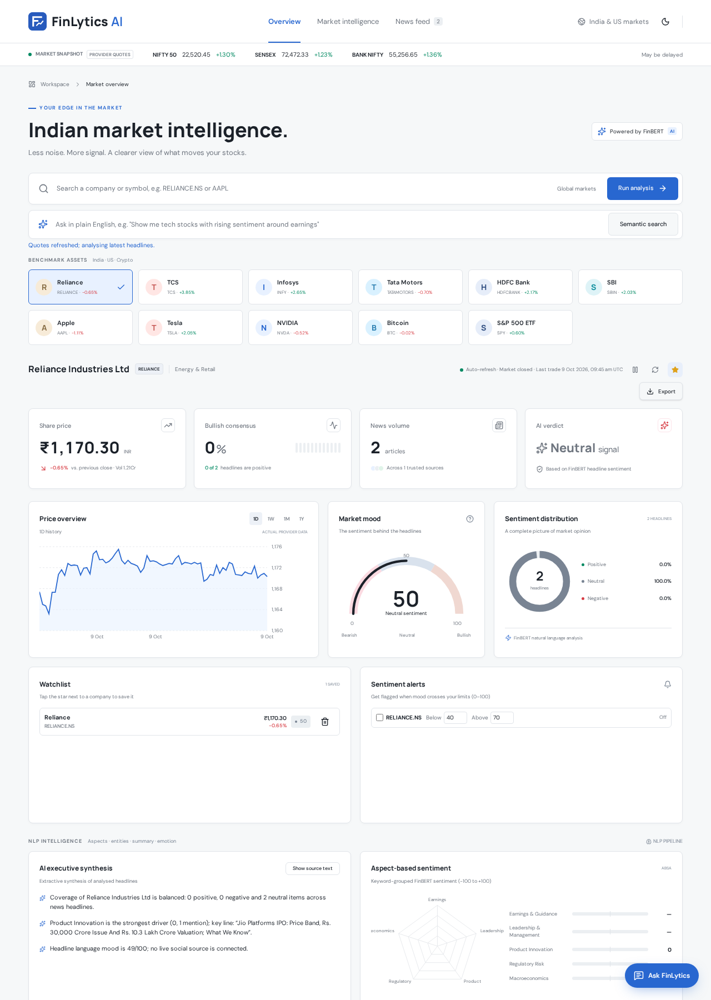
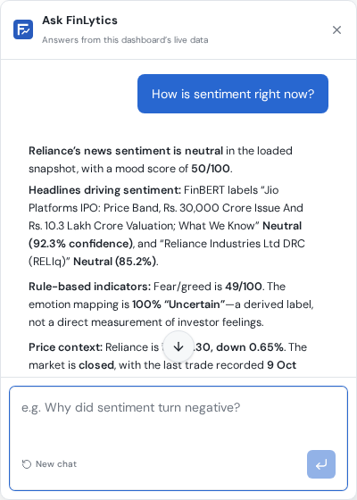

# FinLytics AI — Market Sentiment Dashboard

> An NLP mini-project: a real-time sentiment dashboard for Indian equities, powered by
> **FinBERT** — a BERT transformer fine-tuned on financial text — running entirely in the
> browser.

FinLytics AI pulls live market data and news for NSE-listed stocks, classifies every
headline as Positive / Neutral / Negative with a confidence score, and layers
rule-based analysis (aspects, entities, emotion, alpha signals, backtesting) on top of
the model's output. A built-in chat analyst, **Ask FinLytics**, answers questions using
only the live data currently on screen.

---

## Screenshots

### Dashboard
Live quotes, FinBERT sentiment on real headlines, watchlist, alerts, and the
sentiment-vs-price chart.



### Ask FinLytics chat
The chat analyst, grounded in the live on-screen market data.



---

## Features

- **Live market data** — share prices in ₹ with % change vs. previous close, plus
  NIFTY 50, SENSEX and BANK NIFTY index levels.
- **FinBERT sentiment** — every headline classified in the browser with a confidence
  score; no server-side model, no API token.
- **Derived NLP layers** — aspect-based sentiment, entity/topic extraction, emotion and
  fear-and-greed readings, and an executive synthesis.
- **Institutional panels** — alpha signals (each naming the headline behind it), peer
  comparison, and a one-month sentiment-vs-price backtest on real prices.
- **Ask FinLytics chat** — a floating analyst that answers only from the data on screen.
- **Watchlist, alerts and themes** — stored locally per visitor; no sign-in required.
- **Honest data** — when a source is unreachable, the dashboard says so and leaves the
  value blank. It never displays invented numbers.

## Quick start

See `SETUP.md` for the full step-by-step guide. Short version:

```sh
npm install
npm run dev          # then open the printed http://localhost:8080
```

The first load downloads the FinBERT weights (~40 MB) into the browser cache; later
loads are instant.

## Live market data

Prices and headlines come from two free public endpoints, so no API key or account is
needed. The requests run on the dev server (see `src/lib/market-feed.functions.ts`),
which keeps the browser clear of cross-origin blocks.

| What you see | Where it comes from |
|---|---|
| Share price in ₹ and % change vs. previous close | Yahoo Finance chart endpoint, NSE symbols (`RELIANCE.NS`, `TCS.NS`, `INFY.NS`, `TMCV.NS`, `HDFCBANK.NS`, `SBIN.NS`) |
| NIFTY 50, SENSEX, BANK NIFTY levels | Yahoo Finance (`^NSEI`, `^BSESN`, `^NSEBANK`) |
| Headlines, publisher and publish time | Bing News RSS (`en-IN`), newest first, de-duplicated |

- Prices are in INR, rounded to two decimals, with Indian digit grouping (₹1,170.30).
- Results are cached for 60 seconds so switching stocks doesn't hammer the endpoints.
- Prices only change when a genuinely new quote arrives; when markets are closed the
  price stays still and the last trade time is shown.

## NLP: FinBERT sentiment analysis

Every headline on the page is classified by **FinBERT** into Positive / Neutral /
Negative with a confidence score (softmax probability).

- The model runs **in the browser**, inside a Web Worker (`src/lib/finbert.worker.ts`),
  using `@huggingface/transformers` with the ONNX build of FinBERT (`Xenova/finbert`,
  8-bit quantised, WebAssembly). No Hugging Face token, no Python and no GPU are needed.
- The first run downloads the model weights from the Hugging Face CDN and the browser
  caches them, so later loads are instant.
- Every headline carries its label and confidence, and the verdict card reports the
  model's own status ("Downloading FinBERT", "Analysing headlines", "FinBERT ready")
  instead of a placeholder.
- Offline Python demo: `python nlp/finbert_analyzer.py` runs the same model locally
  with `transformers` and prints each headline's label, confidence and an overall
  market mood.

### Derived NLP layers

The panels below the headline feed are **explicitly rule-based** on top of FinBERT's
labels — they are not additional transformer predictions:

- Aspect-based sentiment across five financial pillars (Earnings & Guidance, Leadership
  & Management, Product Innovation, Regulatory Risk, Macroeconomics).
- Named-entity and topic extraction (competitors, executives, regulators, products).
- Tone / emotion and intent classification, plus a fear-and-greed reading.
- A three-bullet executive synthesis with a toggle back to the original headlines.
- A natural-language query bar that filters the dashboard.
- Institutional panels: alpha signals (each naming the headline behind it), peer
  comparison and a sentiment-vs-price backtest over one month of real prices.

## Ask FinLytics chat

The floating chat answers only from the data currently on screen. It calls the
`/api/chat` server route, which needs a free AI key in your `.env` file — either
`GROQ_API_KEY` or `GEMINI_API_KEY` (see `SETUP.md`). Without a key the chat reports
"unavailable"; everything else works without it.

## Accounts

There is no sign-in. Each visitor's watchlist, alerts and light/dark choice are stored
in their own browser (localStorage), so they stay on that device.

## Project layout

```text
src/routes/            pages and the /api/chat server route
src/components/        dashboard panels, charts, chat, safety fallbacks
src/lib/               market feed, FinBERT worker, rule-based NLP layers
src/hooks/             React hooks wiring the feed and FinBERT
nlp/                   offline Python FinBERT demo
drizzle/               database schema and migrations (unused when run locally)
```

## Other commands

```sh
npm run build     # production build
npm run preview   # serve the production build
npm run lint      # ESLint checks
npm run test      # Vitest
```
